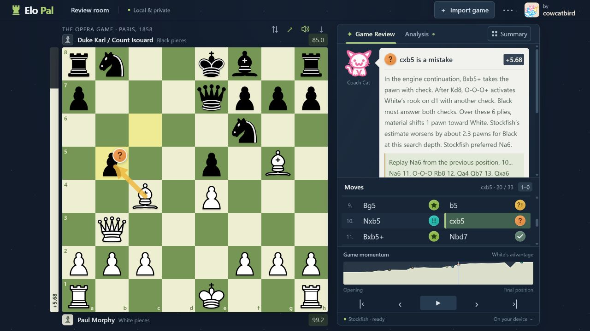

# Elo Pal

[](https://github.com/cowcatbird/elo-pal/actions/workflows/ci.yml)
[](https://github.com/cowcatbird/elo-pal/releases/latest)
[](LICENSE)

**Free chess review on your own computer, by [cowcatbird](https://github.com/cowcatbird).**

[Download the latest release](https://github.com/cowcatbird/elo-pal/releases/latest) · [Report a bug](https://github.com/cowcatbird/elo-pal/issues) · [Privacy](PRIVACY.md) · [Contributing](CONTRIBUTING.md)

A free Chrome extension for reviewing chess games on your own computer. Click Elo Pal on a Chess.com or Lichess game page to import its PGN or main move list and automatically start local Stockfish analysis. Its board-first review screen includes opening names and variations, Book/Great/Brilliant move badges, and Coach Cat's explanations. Everything needed to analyze a position is bundled with the extension.

Elo Pal is an independent project. It offers a familiar game-review workflow, but does not reproduce Chess.com's proprietary accuracy formula, move classifications, opening database, or coaching system. Its review labels and accuracy scores are estimates defined by this project. Search depth and your device affect the engine's conclusions.



## Highlights

- Local Stockfish analysis with no account, subscription, or analysis server.
- One-click Chess.com and Lichess imports, plus manual PGN/FEN and local files.
- Game summaries, custom accuracy estimates, and Brilliant, Great, Book, and other move badges.
- An offline opening explorer and Coach Cat's concrete, position-specific advice.
- Walkable engine lines, legal board exploration, keyboard shortcuts, and move sounds.
- A large board with bundled Cburnett pieces, readable notation, and visible playback controls.

## Install in Google Chrome

1. Download **`elo-pal.zip`** from the [latest release](https://github.com/cowcatbird/elo-pal/releases/latest), extract it, and keep the extracted folder. Keep `vendor/` and `assets/` with it.
2. Open `chrome://extensions` in Chrome.
3. Enable **Developer mode** in the top-right corner.
4. Click **Load unpacked** and select the folder containing `manifest.json`.
5. Pin **Elo Pal** from Chrome's Extensions menu, then click its rook icon.

The extension opens a full review tab. No account, API key, subscription, build step, or server is required. You can also clone this repository or extract GitHub's source ZIP and load its folder directly; Node.js is not required for installation.

To update, extract the new release into your existing extension folder, click **Reload** on its card in `chrome://extensions`, and refresh any open Elo Pal tabs. Unpacked extensions do not update automatically. Version 1.8.1 uses the same `activeTab`, `scripting`, and `storage` permissions for the import you initiate by clicking the toolbar icon. It has no persistent website permissions.

## One-click import from Chess.com or Lichess

1. Open the individual game or its analysis page on Chess.com or Lichess and wait for the board and moves to appear.
2. Click Elo Pal's toolbar icon. The extension reads that tab once, validates the game, and opens it in a new Elo Pal tab.
3. Local analysis starts automatically in the game summary. Once it finishes, select **Start Review** to explore the moves and coach explanations.

On Chess.com, the importer tries the current board's PGN/history and its main move list. On Lichess, it reads the displayed game's PGN export. It ignores variation branches and rejects illegal, truncated, mismatched, or unsupported-variant data when it can detect them. If a page has multiple boards, hides its move history, or either site changes its markup, Elo Pal displays a specific import message and keeps manual PGN import available. It does not guess a game from a profile or an archive listing. On other websites, it opens Elo Pal with instructions to import a game.

Lichess game imports require a completed standard-chess game: its public API delays exports of games in progress, so Elo Pal asks you to return after the game instead of importing a shortened score. The importer also supports a public study's selected chapter and PGN exposed by a standalone analysis board. Private studies or pages without accessible PGN can still be imported manually. The built-in engine does not support chess variants such as Chess960 or Crazyhouse.

Only the clicked page is read; no game is sent to an analysis service. Lichess imports may make one public, same-origin request for that game's PGN without account credentials. The game is handed to Elo Pal through short-lived extension session storage, not placed in a URL. The imported PGN then becomes your locally saved game. There is no ongoing monitoring of either site's board.

## Review a game

- Paste PGN or FEN into the import dialog, or open a `.pgn` file from your computer.
- Try the built-in Opera Game to explore the review interface.
- Games open to a summary with player names, result, accuracy, an evaluation graph, opening, and move-quality totals for both sides. Click **Analyze game** for a manually loaded game; Chess.com and Lichess imports start automatically. Totals update as Stockfish works and remain marked partial until all moves are analyzed. **Start Review** then opens the move-by-move view. The **Summary** button returns to the overview without interrupting an active analysis. Longer analysis takes more time and may change classifications. FEN studies open directly in Analysis.
- Select moves in the move list, use the board navigation controls, or press **A / Left arrow** for the previous move and **D / Right arrow** for the next move. **Home/End** go to the beginning/end, and **F** flips the board when a text field is not focused.
- Explore legal moves on the board and inspect the engine's preferred continuation. Use **Return to game** or **Esc** to leave a variation.
- Colored badges beside the last moved piece show Brilliant, Great, Book, Best, Excellent, Good, Inaccuracy, Mistake, Blunder, or Forced. Crisp SVG symbols are shared by the move list, board, coach, and review breakdown: an open book for theory, a star for Best, double checks for Excellent, and a single check for Good. Book moves are recognized immediately; engine grades appear during review. Badges follow the destination when the board is flipped and are hidden while exploring unreviewed variations.
- Coach Cat sits above the moves. **Explain** opens the reasoning, **Best line** opens a saved engine continuation from the displayed position, and **Next key moment** jumps to a Brilliant or Great move or an error.
- In a saved line, **Previous/Next**, **Home/End**, clickable numbered moves, and **Play** navigate that line. It starts at the current position before the first suggested move. Fresh engine searches do not replace the saved continuation. **Return to game** or **Esc** restores the original game position; moving a piece yourself branches into a free variation. Clicking any of the three engine lines opens the same walkthrough.
- **Play** steps through the game automatically outside a saved line; pause or select a move to stop. Accuracy and grade totals remain available in the expandable review summary.
- Moves play short, locally generated sounds: a soft tap for ordinary moves, a deeper capture, two taps for castling, and distinct chimes for checks, promotions, and checkmate. The speaker above the board or **M** toggles sound and remembers your preference. Forward navigation and explored moves use the move's sound; rewinding uses a neutral tap. Checkmate takes priority over check, followed by promotion, castling, and capture. Engine calculations and repeated selection of the same position stay silent. No downloads, extra permissions, or audio services are needed.
- The board uses the established Cburnett chess piece set, bundled locally with its license and attribution. Move notation and explanations use larger, readable text. On desktop, the move list and playback controls stay visible in a panel sized to the window. Collapsed details use only the space they need, leaving more room for moves. Expanded coach, opening, and analysis details scroll separately; long move histories scroll inside the move list, which follows the selected move.
- Export a PGN when you want a portable copy of the original game. Analysis labels and explored variations are not included in the export.

The evaluation bar holds its last known value while a new position is waiting for analysis, then moves directly to the new score. Its tooltip identifies a previous score until the current position is evaluated. Loading a different game resets the bar.

Engine scores are shown from White's perspective: positive favors White, negative favors Black, and a mate score indicates a forced mate found within the engine's search. A single FEN contains a position; a full game review needs the move history supplied by PGN.

For other websites, download or copy the game's PGN and import it here. Elo Pal is a separate review tab; it does not add engine hints or badges to either site's board. Use it for study and post-game review.

## Opening names and lines

The opening card identifies the current board using 3,865 named lines from the bundled Lichess opening-name dataset, covering all 500 ECO codes. It shows the opening family, named variation, ECO code, and reference move sequence. Plans for both sides and typical things to watch for are available in the opening details. Click a book continuation to try it on the board.

For example, `1. e4 e5 2. f4` is **King's Gambit (C30)**. After `2...exf4`, the name becomes **King's Gambit Accepted**. Recognized opening moves receive **Book**, even when Stockfish prefers a different move. Book means the move belongs to the included repertoire; it does not promise that the move is best or that a gambit gives full compensation. The engine evaluation remains visible separately.

Matching uses legal positions, including castling and en-passant rights, and recognizes transpositions. After leaving the book, the last recognized opening remains visible with an explicit status; later moves are graded by the engine. FEN studies can identify a known position, but a FEN alone cannot prove which opening move was played. Opening names in imported PGN headers are not used to guess an earlier position. The database has broad ECO coverage, but does not include every playable line.

## How review scores work

Elo Pal compares the position before and after each move. It converts centipawn scores into an estimated winning chance using `100 / (1 + exp(-centipawns / 300))`, then measures the chance lost by the player who moved. This is a simple heuristic, not a calibrated probability or Stockfish's WDL model.

| Estimated chance lost | Move label |
| --- | --- |
| At most 1.5 percentage points | Excellent |
| At most 4 points | Good |
| At most 8 points | Inaccuracy |
| At most 16 points | Mistake |
| More than 16 points | Blunder |

The engine's top move is labeled **Best**; a position with only one legal move is labeled **Forced**. Delivering checkmate is also **Best**. These moves score 100. Other moves score `100 × exp(-chanceLost / 15)`, including Brilliant moves that do not match the engine's first choice. Each player's displayed accuracy is the average of their analyzed move scores. Mate scores use a large finite centipawn substitute for this calculation. These transparent rules can produce different labels and accuracy from other analysis products.

**Book (▣)** takes precedence for a recognized opening continuation and scores 100 in the custom accuracy estimate. Its underlying engine loss is retained independently. Book recognition is available before a review, but moves enter the accuracy summary only after analysis.

**Great (!)** identifies a critical engine-first-choice move with a substantial gap over the second legal candidate. Both candidate searches and the resulting position must reach depth 12, with candidate depths within one ply. The gap must be at least two pawns, and the best move must either be the only candidate avoiding a clear disadvantage or the only one retaining a clear advantage. The played result must preserve that outcome; forced moves, terminal positions, and bounded scores do not qualify. Brilliant takes precedence over Great. This is a conservative custom rule, not Chess.com's classification.

**Brilliant (!!)** takes priority over Best when a move satisfies a separate, conservative sacrifice heuristic. Both evaluations must reach depth 12, the mover's resulting score must be at least −0.50, and the move must lose at most 0.50 pawns or 1.5 estimated chance points while retaining any previously found forced mate. A moved knight, bishop, rook, or queen must offer at least one pawn of new material that an opponent can legally accept. The detector checks legal capture exchanges, or a legal engine continuation that accepts the offer and keeps the material invested. Equal trades, already-hanging pieces, forced moves, promotions, immediate checkmates, and incomplete bound scores are excluded. It can miss indirect or longer sacrifices. This is Elo Pal's classification, not Chess.com's proprietary brilliant-move algorithm.

Coach Cat uses a generated portrait of the pink cat from the cowcatbird logo and provides local, rule-based coaching. Explanations name concrete threats and relevant squares, show legal engine continuations, and suggest specific positional plans such as developing a piece or improving a rook. Advice follows the position on the board, including explored variations; explanations of a played move's grade retain the original review scores. Coaching is generated from chess rules and local Stockfish analysis without cloud AI. It describes detected ideas, not every tactic or plan, and can change as the engine searches deeper.

## Local and private

- Chess calculations run on your computer in a background worker.
- `activeTab` grants temporary access to the tab when you click Elo Pal. `scripting` performs the one-time Chess.com or Lichess extraction. `storage` transfers that game privately to the review tab.
- No broad host permissions, background browsing-history access, or continuous page monitoring are used. Lichess imports can request the selected game's public PGN from Lichess; no remote analysis service receives your game.
- Engine files, chess rules, graphics, and styles are packaged locally; no CDNs or analytics are used.
- The latest game PGN, analysis-depth setting, board orientation, and sound preference stay in this browser profile's local storage. No browser sync is used. See [PRIVACY.md](PRIVACY.md) for storage lifetimes and deletion instructions.

## Preview and package from source

Clone with `git clone https://github.com/cowcatbird/elo-pal.git`, then run the commands below from the `elo-pal` folder. All runtime files are vendored, so the preview, tests, and packaging can run without installing npm dependencies. CI also checks the project on Windows and Linux using Node.js 24.

Only these optional developer commands require Node.js 20 or later:

```sh
node scripts/serve.mjs
```

Open `http://127.0.0.1:4173`. This preview uses the same board and engine as the extension. Stop it with Ctrl+C. The server binds only to this computer; set the `PORT` environment variable if port 4173 is already in use.

```sh
node scripts/package.mjs
```

This creates `dist/elo-pal.zip` without external packaging dependencies. The archive contains the extension, bundled engine, documentation, and third-party notices. Extract it before using **Load unpacked**.

To restore the pinned development dependencies, refresh the vendored runtime files, and run the automated checks:

```sh
npm ci --ignore-scripts
npm run vendor
npm test
npm run test:smoke
```

`npm ci` needs a network connection. The tests and engine smoke check run locally; the smoke check exercises the bundled WebAssembly engine. These development steps are optional when installing the ready-made extension. The ZIP includes `package.json`, `package-lock.json`, `scripts/`, and `tests/` for reproducibility.

`node scripts/build-openings.mjs` rebuilds the opening index from the included pinned TSV sources without a network connection. Source and generated-file hashes are recorded in `vendor/openings/provenance.json`.

See [CONTRIBUTING.md](CONTRIBUTING.md) for the project layout, pull-request checklist, and release process.

## Troubleshooting

- **The extension does not load:** select the extracted folder that directly contains `manifest.json`, rather than its parent or ZIP file.
- **The engine cannot start:** check that the complete `vendor/` folder was retained, reload the extension, and refresh the Elo Pal tab. Use a current desktop Chrome version with WebAssembly support.
- **The game does not import:** use PGN with legal moves or a valid six-field FEN. A screenshot or a webpage URL is not PGN.
- **Review takes time:** local analysis uses your CPU. A deeper search and longer game need more computation; choose a quicker analysis setting when available.
- **Results differ from a website:** engine versions, depth, time budgets, and classification formulas can differ. A review is an aid to study, not a guarantee of the only correct move.

For other problems, [open an issue](https://github.com/cowcatbird/elo-pal/issues) with your browser and extension versions and a reproducible, non-private PGN/FEN. Report vulnerabilities through [SECURITY.md](SECURITY.md). See [CHANGELOG.md](CHANGELOG.md) for release notes.

## License and third-party software

Elo Pal's original source code, documentation, and icons are free software under the GNU General Public License, version 3 only (`GPL-3.0-only`). The bundled chess pieces retain their upstream license and attribution, included in `vendor/pieces/` and [THIRD_PARTY_NOTICES.md](THIRD_PARTY_NOTICES.md). See [LICENSE](LICENSE) for the project's license text. The software is provided without warranty.

Bundled third-party software retains its own licenses. See [THIRD_PARTY_NOTICES.md](THIRD_PARTY_NOTICES.md) and the accompanying `vendor/` files for the exact versions, license texts, and upstream source/build links. Elo Pal bundles the Stockfish.js 19.0.1 Lite single-threaded WebAssembly engine and chess.js 1.4.0. The Lite engine uses a smaller neural network than full Stockfish; analysis may differ even at the same search depth.
